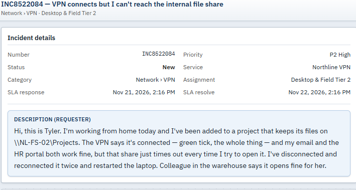
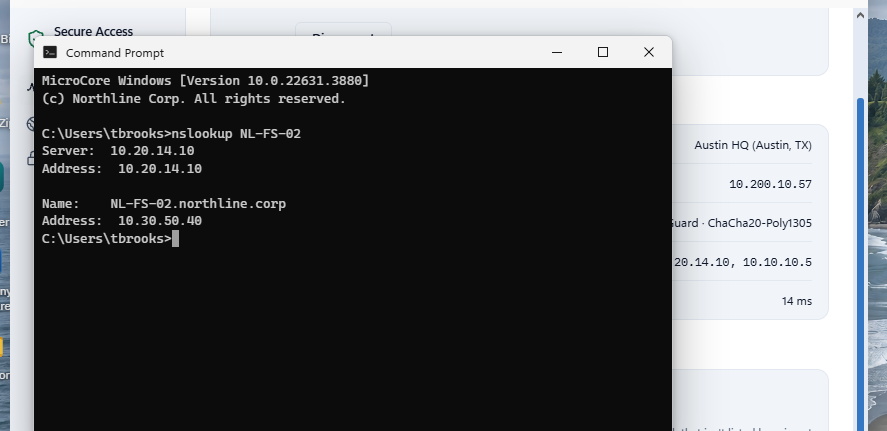
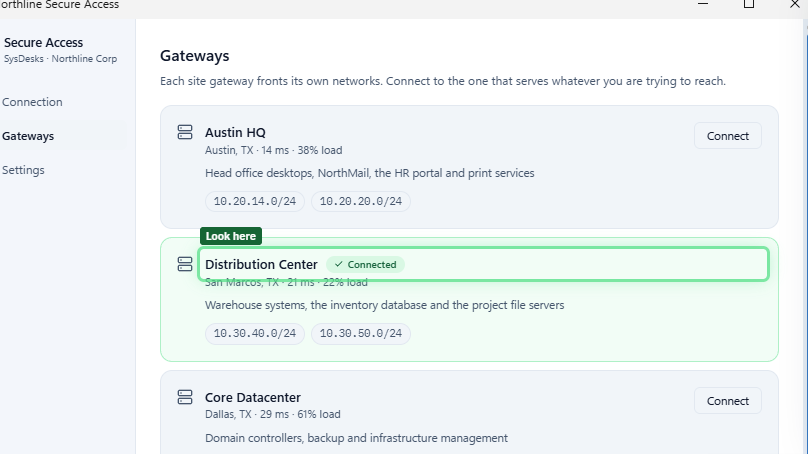
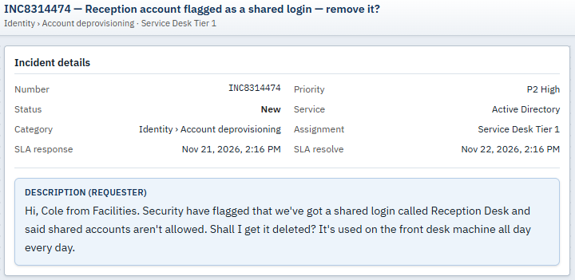
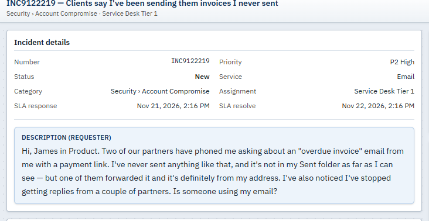
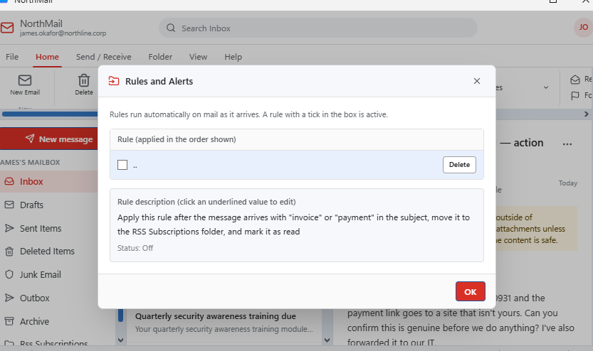
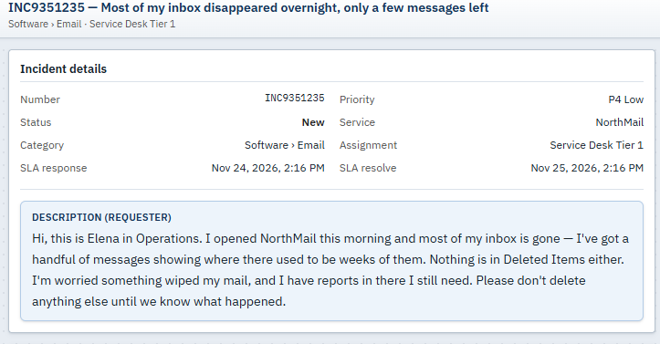
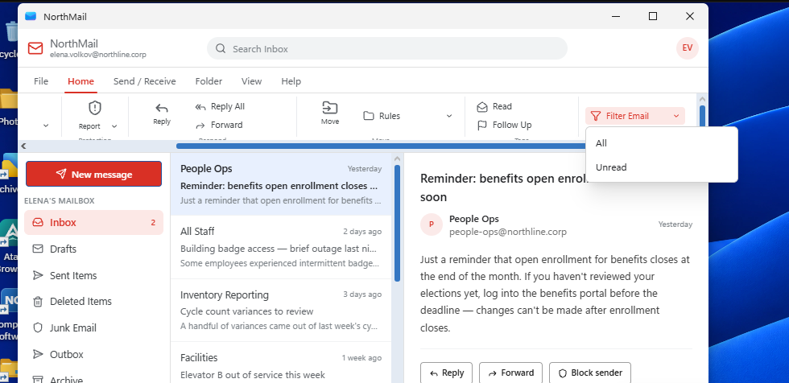
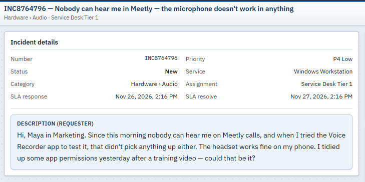
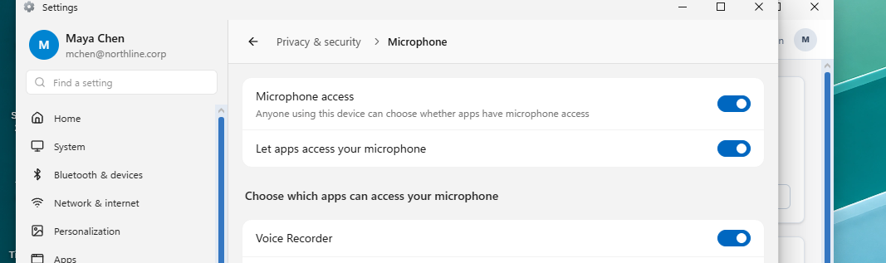

<h1>Week 6 of Helpdesk Exercise</h1>

Helpdesk simulator: <a href = "https://www.google.com/url?sa=t&rct=j&q=&esrc=s&source=web&cd=&cad=rja&uact=8&ved=2ahUKEwjEibuwjZiYAxUI96ACHQxxKQ0QFnoECA8QAQ&url=https%3A%2F%2Fsysdesks.com%2F&usg=AOvVaw3JZRWmcdfUv9AB3_rGtlEy&opi=89978449">Sysdesk</a>

<h2>Ticket 1</h2>

<strong>Problem Description:</strong>

The employee is connected to the company VPN (status shows "Connected") but cannot access the network shared files. The user attempted to reboot the device, which did not resolve the issue.

<strong>Steps Taken:</strong>

<ul>
  <li>Verified that the client device had an active VPN tunnel connection.</li>
  <li>Tested Layer 3 reachability by pinging the file server's subnet gateway, resulting in 100% packet loss.</li>
  <li>Checked the assigned VPN IP/gateway configuration and confirmed the client was placed on a different subnet/gateway than the file server.</li>
</ul>

<strong>Root Cause: </strong>

Although the VPN tunnel was established, the client was assigned to a VPN subnet/gateway that lacks routing or access to the network segment hosting the shared files.

<h2>Ticket 2</h2>

<strong>Problem Description:</strong>

A shared login account named "Reception Desk" was flagged by the Security team in accordance with company policy prohibiting shared accounts. The user inquired whether the account should be deleted.

<strong>Steps Taken:</strong>

<ul>
  <li>Reviewed the request and determined that deprovisioning or deleting the shared account requires authorization from Human Resources and management.</li>
  <li>Escalated the ticket to the appropriate team/HR for formal approval and further action in accordance with account lifecycle procedures.</li>
</ul>

<h2>Ticket 3</h2>

<strong>Problem Description:</strong>

User (James, Product) reported that external partners received fraudulent "overdue invoice" emails containing payment links from his email address, which were not visible in his Sent folder. He also noticed missing replies from certain partners and suspected unauthorized account access.

<strong>Steps Taken:</strong>

<ul>
  <li>Enforced a password reset at next logon for the user's account in Active Directory.</li>
  <li>Initiated a remote session to inspect the user's email client settings and inbox rules.</li>
  <li>Identified and disabled a malicious email rule configured to automatically mark incoming messages as read and delete emails to conceal activity.</li>
  <li>Prepared the ticket for escalation to the Security/Tier 2 team for further forensic investigation.</li>
</ul>

<strong>Root Cause: </strong>

Unauthorized access to the user's email account allowed an attacker to send phishing emails and create a malicious inbox rule that automatically hid replies and sent items from the user.

<h2>Ticket 4</h2>

<strong>Problem Description:</strong>

User (Elena, Operations) reported that most of her inbox messages in NorthMail were missing, leaving only a few emails visible with nothing found in the Deleted Items folder. She was concerned that her emails had been wiped, including important reports she still needed.

<strong>Steps Taken:</strong>

<ul>
  <li>Initiated a remote session to the user's device and opened the NorthMail client.</li>
  <li>Checked the mailbox view settings after noticing an active filter notification.</li>
  <li>Located and cleared the active inbox view filter, restoring visibility to all existing messages.</li>
</ul>

<strong>Root Cause: </strong>

An active view filter in NorthMail was hiding older messages from the inbox, giving the appearance that the emails had been deleted.

<h2>Ticket 5</h2>

<strong>Problem Description:</strong>

User (Maya, Marketing) reported that her microphone stopped working across all applications since this morning—colleagues could not hear her on Meetly calls, and the Voice Recorder app failed to capture any audio.

<strong>Steps Taken:</strong>

<ul>
  <li>Navigated to the operating system's Settings > Privacy & Security > Microphone menu.</li>
  <li>Identified that global/app microphone access permissions were toggled off.</li>
  <li>Re-enabled microphone permissions and verified that audio input worked properly.</li>
</ul>

<strong>Root Cause: </strong>

System-level microphone privacy permissions were disabled, blocking Meetly and Voice Recorder from accessing the microphone hardware.

<h2>Weekly Learning: </h2>

Working through those five tickets really sharpened a few core skills that every helpdesk beginner needs:

<ol>
  <li>Checking the simple, local settings before assuming a major failure In Elena's missing emails ticket and Maya's microphone issue, it would have been easy to jump straight to worst-case scenarios like corrupted mailboxes or broken hardware. Instead, I practiced starting with basic configuration checks—spotting an active view filter in NorthMail and checking OS-level privacy permissions. That habit saves a ton of time and prevents unnecessary escalations.</li>
  <li>Knowing when to contain, document, and escalate rather than overstepping Handling James's compromised email account and the flagged "Reception Desk" shared login taught me the importance of boundaries and governance. With James, I took immediate containment steps—forcing a password reset in Active Directory and disabling the malicious inbox rule—before escalating to Security for deeper investigation. With the shared account, I recognized that deleting a domain profile isn't just a technical button-click; it's a policy and HR decision, so escalating it properly protects both the company and me.</li>
  <li>Distinguishing between "connected" and "reachable" during network troubleshooting In the VPN ticket, seeing "Connected" on the user's screen didn't mean the job was done. Using ping to verify Layer 3 reachability helped me realize the client was on a different subnet or gateway than the file server. It reinforced how to isolate network issues step-by-step rather than blindly telling a user to reboot again.</li>
  <li>Translating messy user symptoms into clear, structured documentation Across all five tickets, users described their problems emotionally or casually—worrying their emails were wiped or asking if someone was using their account. Turning those conversations into structured notes with a clear problem description, concrete troubleshooting steps, and an accurate root cause made my handoffs much cleaner for Tier 2 and Security.</li>
</ol>
